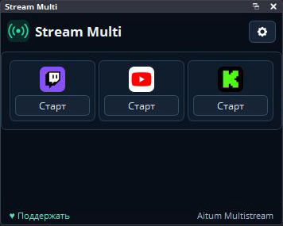

# OZK Multi for OBS

Часть набора **OZK StreamKit** от OTMOPOZOK. Работает и отдельно от остальных плагинов.

**Сборка 0.1.5 для проверки:** новая шапка OZK; кнопки показывают запуск, эфир, переподключение и ошибку; нижняя строка стала компактнее. Работу с реальным эфиром нужно проверить в OBS.

**OZK Multi — плагин мультистрима для OBS Studio:** управляет несколькими горизонтальными трансляциями на Twitch, YouTube, Kick и другие площадки из одной панели. Вертикальные сцены и их настройки в этой версии не используются.

Разработчик оформления и адаптации: **DMITRII / [OTMOPOZOK](https://www.youtube.com/channel/UCTAKYR3T2Ud8zZgNShgQfyw/)**. Проект основан на открытом [Aitum Multistream](https://github.com/Aitum/obs-aitum-multistream) команды Aitum и Exeldro. Их авторство и лицензия GPL-2.0 сохранены.

## Что делает

- Показывает встроенную трансляцию OBS и дополнительные выводы Twitch, YouTube, Kick и других платформ.
- Позволяет запускать и останавливать каждый вывод из панели. Кнопка показывает запуск, активный эфир, переподключение и ошибку; причину ошибки можно посмотреть при наведении.
- Располагает выводы компактными карточками: значок платформы над кнопкой «Старт» или «Стоп». Количество колонок меняется вместе с шириной панели; название вывода видно при наведении.
- Сохраняет настройки выводов отдельно для каждого профиля OBS.
- При первом запуске копирует настройки горизонтальных выводов Aitum Multistream, если они есть. Исходный файл Aitum остаётся без изменений.

## Как установить

Скачайте **OZKMulti-0.1.5-OBS33-Windows-x64** на странице [последней успешной сборки](https://github.com/DIMI0007/ozk-multi/actions/workflows/build-windows.yml). Эта версия собрана для OBS Studio 33 и пока требует проверки в OBS.

1. Закройте OBS.
2. Распакуйте архив и скопируйте папку `stream-multi` в `C:\ProgramData\obs-studio\plugins\`. Если папки `plugins` нет, создайте её.
3. Запустите OBS и откройте панель **OZK Multi** через меню **Док-панели**. Дополнительные выводы настраиваются кнопкой с шестерёнкой.

Если у вас уже есть Aitum Multistream, отключите его перед запуском OZK Multi, чтобы случайно не отправить два потока на один адрес. Исходные настройки Aitum при переносе не удаляются.

OZK Multi работает независимо от OZK Chat, OZK Notify и OZK Stats. При установленном OZK Stats дополнительные активные выводы учитываются в общей статистике трансляции OBS. Папка и DLL пока сохраняют внутреннее имя `stream-multi`, чтобы не терять настройки выходов и место панели OBS.

## Исходный код и права

Исходный код Aitum Multistream распространяется по [GPL-2.0](LICENSE). Изменённые файлы и дата изменений перечислены в [NOTICE.md](NOTICE.md). [Исходная инструкция сборки](README_UPSTREAM.md) также сохранена.

## Поддержать проект

Если наши плагины полезны, поддержите их развитие: [поддержать проект](https://dalink.to/otmopozok) можно и вне эфира. Также доступен [DonatePay](https://donatepay.ru/don/OTMOPOZOK).
